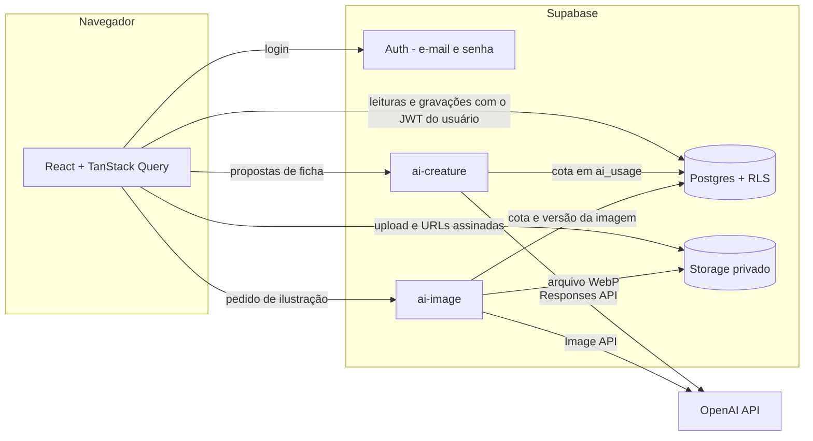

# Bestiario

Plataforma web para mestres de RPG criarem e organizarem bestiários por universo de campanha, com fichas no padrão **D&D 5e** e uma IA que atua como parceira criativa (texto e ilustrações), sem tirar do mestre a palavra final.

## Funcionalidades

- **Cadastro e login com e-mail e senha** (Supabase Auth). Senha com pelo menos 6 caracteres, com letras e números, e mensagens de erro em português.
- **Meus Mundos**: universos com capa, gênero, ambientação, época, nível de fantasia, regras particulares e estilo visual. Cada um tem o próprio bestiário.
- **Criaturas**: grade com busca por nome, filtros por categoria, habitat e nível de ameaça, e ordenação (A–Z, Z–A, ND, recentes).
- **Ficha D&D 5e completa**:
  - informações gerais, atributos, combate, testes de resistência, perícias, resistências e imunidades, sentidos e idiomas;
  - traços, ações, ações bônus, reações, ações lendárias, habilidades especiais e a crônica narrativa;
  - a parte mecânica e a narrativa são visualmente separadas;
  - calculadoras de PV e de bônus, e a referência de equilíbrio do Guia do Mestre para o ND.
- **Criar, editar, duplicar e excluir** fichas, com confirmação e aviso de alterações não salvas.
- **Criar com IA**: descrição livre e configurações (tipo, ND, criatividade, detalhamento, número de propostas, contexto do universo). As propostas aparecem em abas e podem ser salvas, descartadas, combinadas campo a campo, modificadas, editadas à mão, ilustradas, ou virar base de novas alternativas e variações.
- **IA dentro da ficha**: pedidos rápidos ou pedido livre com foco num campo. Toda sugestão chega como **diferença campo a campo**, e o mestre escolhe o que aplicar.
- **Ilustrações por IA**, só quando pedidas: gerar, novas versões, alterações por texto (inclusive editando a imagem atual), comparar, aceitar, substituir, remover ou enviar a própria imagem.

## Arquitetura

| Camada | Tecnologia |
|---|---|
| Frontend | React 19, TypeScript, Vite, Tailwind CSS 4, React Router 7, TanStack Query, lucide-react |
| Autenticação | Supabase Auth com e-mail e senha |
| Banco de dados | Supabase Postgres com Row Level Security |
| Arquivos | Supabase Storage (bucket privado `bestiario`, URLs assinadas) |
| IA (texto) | OpenAI Responses API (`gpt-6.1-sol` por padrão), via Edge Function `ai-creature`, com saída JSON estruturada estrita |
| IA (imagens) | OpenAI Image API (`gpt-image-2.5-flare` por padrão), via Edge Function `ai-image` |



**Segurança em camadas**
- A chave da OpenAI fica **só** nos secrets das Edge Functions; o navegador envia apenas o JWT do usuário.
- As funções usam um cliente Supabase autenticado como o próprio usuário, então até elas passam pela RLS.
- Cada usuário tem uma **cota diária** de pedidos de IA (texto e imagem), registrada em `ai_usage`. Ninguém consegue apagar o próprio histórico para burlar a cota.
- As funções recusam corpos acima de 256 KB e podem restringir as origens com `ALLOWED_ORIGINS`.

**A IA propõe, o mestre decide.** As funções nunca gravam fichas: devolvem propostas, e o app só salva o que o mestre aceitar. Notas do mestre e imagem nunca são alteradas pela IA.

### Estrutura

```
src/
  pages/           telas (carregadas sob demanda, uma por rota)
  components/      UI reutilizável, layout, ficha, editor, IA, imagens, universo
  context/         sessão (e-mail e senha) e universo atual
  hooks/queries.ts consultas com TanStack Query
  lib/             tipos, regras de D&D 5e, acesso a dados, cliente de IA, testes
supabase/
  migrations/      esquema, RLS, Storage, cota de IA
  functions/
    _shared/       auth, HTTP, cota, adaptador da OpenAI, esquema da ficha
    ai-creature/   gerar, variar e modificar criaturas
    ai-image/      gerar e editar ilustrações
  tests/           teste de integração de segurança (RLS, Storage, cota)
.claude/rules/     regras de padronização para agentes de IA (ver CLAUDE.md)
.github/           CI de Pull Request e modelo de PR
```

### Dados

- `profiles` nasce no cadastro (trigger) com o nome informado; o usuário só altera o nome de exibição e as preferências de IA.
- `universes`, `creatures` e `creature_images` pertencem ao usuário (`user_id = auth.uid()`). Criaturas e versões só podem ser gravadas em universos do próprio usuário.
- `creature_images` guarda as versões de ilustração; a escolhida fica em `creatures.image_path`.
- `ai_usage` registra cada pedido à IA para a cota diária.
- Storage: arquivos em `<user_id>/<universe_id>/...`; as políticas só liberam a pasta do próprio usuário.

## Como rodar

### 1. Pré-requisitos

- Node.js 20 ou superior
- Um projeto no [Supabase](https://supabase.com) e o [Supabase CLI](https://supabase.com/docs/guides/cli) (`npx supabase` funciona)
- Uma chave da [OpenAI](https://platform.openai.com)
- Docker, para o Supabase local e para `npm run check:functions`

### 2. Banco de dados

```bash
npx supabase login
npx supabase link --project-ref SEU_PROJECT_REF
npx supabase db push            # aplica supabase/migrations
```

### 3. Autenticação

No painel do Supabase, em **Authentication → Sign In / Providers → Email**:
1. Provedor **Email** ativo, com cadastro permitido.
2. **Confirm email** desligado para o fluxo básico (a conta entra logada logo após o cadastro). Se preferir manter a confirmação, o app já avisa o usuário para confirmar pelo link antes de entrar.
3. Senha mínima de **6 caracteres** com **letras e números** (o app valida o mesmo antes de enviar).
4. **Secure password change**, **Secure email change** e **Require current password when updating** ativos.
5. Em **Authentication → URL Configuration**, defina o *Site URL* com a URL do app.

### 4. Edge Functions (IA)

```bash
cp supabase/functions/.env.example supabase/functions/.env   # preencha OPENAI_API_KEY
npx supabase secrets set --env-file supabase/functions/.env
npx supabase functions deploy ai-creature
npx supabase functions deploy ai-image
```

| Variável | Padrão | Para quê |
|---|---|---|
| `OPENAI_API_KEY` | (obrigatória) | chave da OpenAI |
| `OPENAI_TEXT_MODEL` | `gpt-6.1-sol` | modelo de texto; precisa aceitar saída estruturada e `reasoning.effort` |
| `OPENAI_IMAGE_MODEL` | `gpt-image-2.5-flare` | modelo de imagem |
| `AI_DAILY_TEXT_LIMIT` | `40` | pedidos de texto por usuário a cada 24 horas |
| `AI_DAILY_IMAGE_LIMIT` | `15` | imagens por usuário a cada 24 horas |
| `ALLOWED_ORIGINS` | (vazio = qualquer) | origens que podem chamar as funções, separadas por vírgula |

### 5. Frontend

```bash
cp .env.example .env.local      # VITE_SUPABASE_URL e VITE_SUPABASE_ANON_KEY (Project Settings → API)
npm install
npm run dev                     # http://localhost:5173
```

Para produção, `npm run build` gera `dist/`, que pode ir para qualquer hospedagem estática (Vercel, Netlify, Cloudflare Pages). Configure a hospedagem para reescrever todas as rotas para `index.html` (SPA), acrescente a URL de produção nas Redirect URLs do Supabase e em `ALLOWED_ORIGINS`.

### Desenvolvimento local com o Supabase CLI

`supabase/config.toml` já vem com cadastro e login por e-mail e senha, sem confirmação de e-mail:

```bash
npx supabase start                                    # Postgres, Auth, Storage, Edge Runtime (Docker)
npx supabase functions serve --env-file supabase/functions/.env
```

Use a URL e a anon key mostradas pelo `supabase start` no `.env.local`.

## Scripts

| Comando | O que faz |
|---|---|
| `npm run dev` | servidor de desenvolvimento |
| `npm run build` | checagem de tipos e build de produção |
| `npm run typecheck` | só a checagem de tipos |
| `npm test` | testes unitários: regras de D&D, revisão de alterações da IA, consistência dos enums entre frontend, funções e banco, normalização da saída da IA e prompt de imagem |
| `npm run test:rls` | teste de integração de segurança contra o Supabase local (rode `npx supabase start` antes) |
| `npm run check:functions` | checagem de tipos das Edge Functions (Deno via Docker), igual ao CI |

## Integração contínua

Todo Pull Request e todo push na `main` rodam `.github/workflows/ci.yml`, com três jobs:
- **Frontend**: tipos, testes unitários e build.
- **Edge Functions**: `deno check`.
- **Banco**: migrações do zero e `npm run test:rls`.

Recomenda-se proteger a `main` no GitHub exigindo esses três checks.

## Desenvolvendo com IA

O repositório é **IA-first**. O `CLAUDE.md` traz as regras gerais, e `.claude/rules/` traz as regras por tema: código, textos, design, frontend, ficha de D&D, IA, banco, Edge Functions, segurança, testes e git. Elas valem para pessoas e agentes: siga o padrão existente e não crie padrão novo sem combinar.

## Notas sobre a IA

- O texto usa saída estruturada estrita (JSON Schema) e um guia de equilíbrio com a tabela de estatísticas por ND do Guia do Mestre.
- Na modificação, a IA devolve a ficha inteira e o app calcula a diferença. O mestre vê cada campo alterado lado a lado com o atual.
- As chamadas usam `store: false` (o conteúdo não fica guardado na OpenAI) e tempo-limite de 140 s.
- O prompt da imagem é montado a partir da ficha e do estilo do universo, sem chamada extra de texto. Nada é gerado sem um clique do usuário.
- Ilustrações de propostas descartadas são apagadas na hora; as abandonadas são recolhidas depois de 7 dias.
- Tipos de criatura: além dos 13 tipos pedidos, o sistema inclui **Humanoide**, que também é tipo oficial de D&D 5e.

## Próximas versões

Compartilhamento de bestiários, biblioteca pública de criaturas e colaboração entre usuários.
